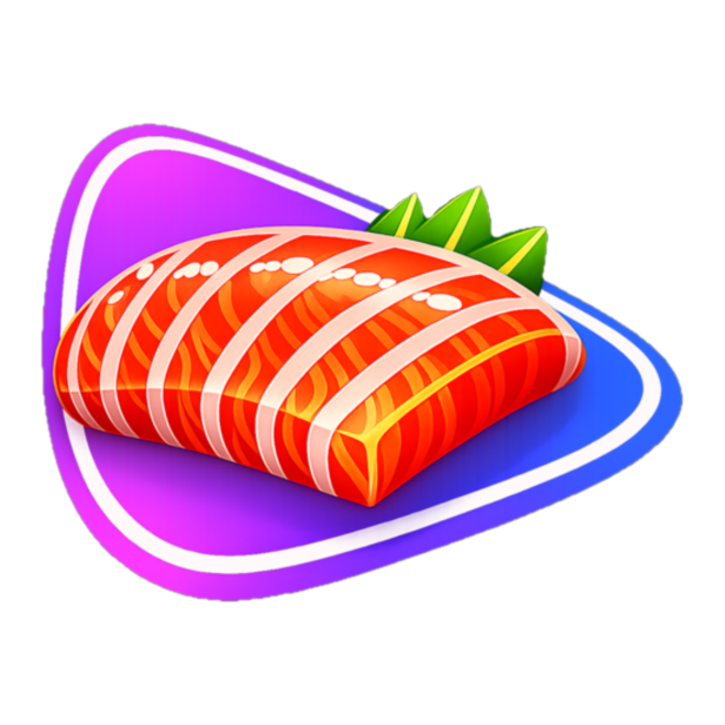

# Sashimi

<p align="center">
  
</p>

<p align="center">
  <strong>A native Jellyfin client for Apple TV, iPhone, iPad and Mac</strong>
</p>

<p align="center">
  <a href="#features">Features</a> •
  <a href="#get-more-out-of-sashimi">Add-ons</a> •
  <a href="#requirements">Requirements</a> •
  <a href="#installation">Installation</a> •
  <a href="#development">Development</a> •
  <a href="#contributing">Contributing</a>
</p>

---

Sashimi is a SwiftUI Jellyfin client for Apple TV, iPhone, iPad and Mac. One
App Store purchase covers all of them (Universal Purchase). The apps share their
networking, sign-in and playback code. The Mac app is the iPad app built with
Mac Catalyst.

## Features

**All platforms**
- Browse and stream your Jellyfin library: movies, shows, and YouTube-style channels
- Continue Watching, with progress synced to the server
- Several servers on one device, with sign-in by server discovery or address
- Audio and subtitle track selection, plus a quality menu. **Auto** quality picks
  a bitrate from what your connection has proven it can carry, and copies the
  original 4K stream when the link is fast enough
- HDR and Dolby Vision play as HDR. A Dolby Vision file the screen can't show is
  transcoded rather than played with wrong colors
- **Up Next** countdown at the end of an episode, with Auto-Play Next Episode
- **Skip Intro / Skip Credits** buttons, with optional auto-skip
- **Theme songs** on series pages, and **trailers** that play behind a title's
  detail page (both need the server add-ons below)
- **Channels** row and a TV-style **guide** for the 24/7 channels on your server
- Shuffle one random item from a library or a show
- Quality badges (4K / HD / SD) on cover art, and the stream bitrate on the player
- **Server dashboard** for Jellyfin administrators: who is watching, with Stop and
  Send message
- Administrators can also add a title to a channel or manage channels from the app
- Credentials kept in the Keychain

**Apple TV**
- Top Shelf shows recent items and opens them (or starts playback) through
  `sashimi://` links
- Player View Mode: Normal, Zoom or Stretch

**iPhone & iPad**
- Offline mode: download movies and episodes and watch without a connection
- Picture-in-Picture
- Siri, Shortcuts and Spotlight: search your library, play a title, or ask for
  the latest additions
- Tabs on iPhone, a sidebar on iPad

**Mac**
- The iPad app in a window, with menu-bar commands and keyboard shortcuts

## Get more out of Sashimi

Sashimi works with a plain Jellyfin server. These add-ons make it better. All of
them are optional, and each one only adds to the app, so nothing breaks without it.
The first three are made by Bitstorm Labs. The last two are separate projects by
other people; see [Acknowledgments](#acknowledgments).

| Add-on | What it does | In Sashimi | Without it |
| --- | --- | --- | --- |
| [Continue Watching](https://github.com/bitstorm-labs/jellyfin-plugin-continue-watching) plugin | Merges Resume and Next Up into one ranked row on the server | The Home row comes straight from the server (`GET /ContinueWatching`) | Sashimi builds the row itself from Resume and Next Up |
| [Channels](https://github.com/bitstorm-labs/jellyfin-plugin-channels) plugin | 24/7 virtual channels made from your library | Channels row and guide on Home. Administrators can add titles and manage channels from the app | No channels row or guide |
| [Theme Songs](https://github.com/bitstorm-labs/jellyfin-theme-songs) plugin | Downloads a `theme.mp3` for each series | Theme music on series pages (Settings, Play Theme Songs). Apple TV, iPhone and iPad | Series pages stay quiet |
| [Intro Skipper](https://github.com/intro-skipper/intro-skipper) plugin, by the Intro Skipper team (not Bitstorm Labs) | Finds intros and credits and writes them to Jellyfin's Media Segments | Skip Intro and Skip Credits buttons (Skip Credits goes straight to Up Next). Sashimi reads `/MediaSegments`, and falls back to Intro Skipper's own route on servers older than 10.10 | No skip buttons. Up Next still appears when the episode ends |
| [Trailarr](https://github.com/nandyalu/trailarr), a separate app by nandyalu (not Bitstorm Labs) | Downloads trailers next to your movies and shows | A trailer button, and the trailer playing behind the detail page (Settings, Play Trailers on Detail Pages) | No trailer button |

The Theme Songs plugin installs from a Jellyfin plugin repository. Add
`https://raw.githubusercontent.com/bitstorm-labs/jellyfin-theme-songs/main/manifest.json`
under Dashboard, Plugins, Repositories. For the others, follow the install notes in
their repositories.

Two more things on the server help:
- **Hardware transcoding.** Auto quality works best when the server can transcode
  quickly, because it falls back to a transcode when the original won't fit.
- **Administrator account.** The Server dashboard and channel management only
  appear for Jellyfin administrators.

## Requirements

- tvOS 17+, iOS / iPadOS 17+, macOS with Mac Catalyst support
- A Jellyfin server (local or remote). Skip segments need Jellyfin 10.10 or newer
- To build: Xcode 26 or newer (the Mac and iOS builds ship with Xcode 27, tvOS
  with Xcode 26) and [XcodeGen](https://github.com/yonaskolb/XcodeGen), which
  generates the Xcode project from `project.yml`

## Installation

### From Source

1. Clone the repository:
   ```bash
   git clone https://github.com/bitstorm-labs/sashimi-apple.git
   cd sashimi-apple
   ```

2. Run the setup script (installs hooks, generates the project):
   ```bash
   ./scripts/setup.sh
   ```

3. Open `Sashimi.xcodeproj` in Xcode

4. Select your development team in Signing & Capabilities

5. Choose a scheme and run:
   - **Sashimi** → Apple TV (tvOS)
   - **SashimiMobile** → iPhone / iPad (iOS), or "My Mac (Mac Catalyst)"

### Dependencies

- [Nuke](https://github.com/kean/Nuke) - Image loading and caching (iPhone, iPad and Mac)

## Development

### Project Structure

```
sashimi/
├── Sashimi/          # tvOS app (SwiftUI)
├── SashimiMobile/    # iPhone, iPad and Mac Catalyst app (SwiftUI)
│   ├── Views/        # Phone/iPad layouts, player, downloads
│   ├── Downloads/    # Background downloads & offline storage
│   ├── AppIntents/   # Siri, Shortcuts, Spotlight
│   └── Mac/          # Mac menu commands and window handling
├── TopShelf/         # tvOS Top Shelf extension
├── Shared/           # Code shared by tvOS + iOS
│   ├── Services/     # JellyfinClient, SessionManager, server discovery
│   ├── ViewModels/   # Player and home view models
│   └── Models/       # Jellyfin API data models
└── SashimiTests/     # Unit tests
```

### Build Commands

```bash
# Generate the Xcode project (requires XcodeGen)
xcodegen generate

# Build the tvOS app
xcodebuild -project Sashimi.xcodeproj -scheme Sashimi \
  -destination 'platform=tvOS Simulator,name=Apple TV 4K (3rd generation)'

# Build the iOS app (iPhone/iPad). Run `xcrun simctl list devices` for names
xcodebuild -project Sashimi.xcodeproj -scheme SashimiMobile \
  -destination 'platform=iOS Simulator,name=iPhone 17'
```

### Releases

Merging app code to `main` ships a TestFlight build of tvOS, iOS and Mac
automatically: `auto-release.yml` waits 15 minutes for more merges, then runs the
Release workflow, which bumps the version through a PR, tags it and deploys.
Docs, tests, CI and fastlane changes ship nothing. Maintainers can also run
**Actions → Release** by hand. Full runbook: [docs/RELEASING.md](docs/RELEASING.md).

### Git Hooks

This project uses git hooks for code quality. After cloning, run:

```bash
git config core.hooksPath .githooks
```

Or use the setup script which configures this automatically.

## Contributing

1. Fork the repository
2. Create a feature branch: `git checkout -b feat/my-feature`
3. Commit using conventional commits: `git commit -m "feat: add new feature"`
4. Push to your fork: `git push origin feat/my-feature`
5. Open a Pull Request

### Commit Message Format

This project uses [Conventional Commits](https://www.conventionalcommits.org/):

- `feat:` - New features
- `fix:` - Bug fixes
- `docs:` - Documentation changes
- `style:` - Code style changes
- `refactor:` - Code refactoring
- `test:` - Test updates
- `chore:` - Maintenance tasks

## License

This project is licensed under the MIT License - see the [LICENSE](LICENSE) file for details.

## Acknowledgments

Sashimi is built on, and works with, other people's projects. Each one is a
separate project under its own license. Sashimi is not affiliated with or
endorsed by any of them.

**The server**

- [Jellyfin](https://jellyfin.org/) (the Jellyfin project, GPL-2.0). The free
  software media system Sashimi is a client for.

**Server add-ons Sashimi works with** (not made by Bitstorm Labs)

- [Intro Skipper](https://github.com/intro-skipper/intro-skipper) (by the Intro
  Skipper team, GPL-3.0). Detects intros and credits. Sashimi reads the
  segments it writes to Jellyfin and shows the Skip buttons.
- [Trailarr](https://github.com/nandyalu/trailarr) (by nandyalu, GPL-3.0).
  Downloads trailers next to your media. Sashimi plays them behind the detail page.

**Libraries and tools**

- [Nuke](https://github.com/kean/Nuke) (kean, MIT). Image loading and
  caching on iPhone, iPad and Mac.
- [XcodeGen](https://github.com/yonaskolb/XcodeGen) (yonaskolb, MIT). Generates
  the Xcode project from `project.yml`.

The TMDb and Rotten Tomatoes logos next to ratings belong to their owners. The
ratings themselves come from your Jellyfin server.
